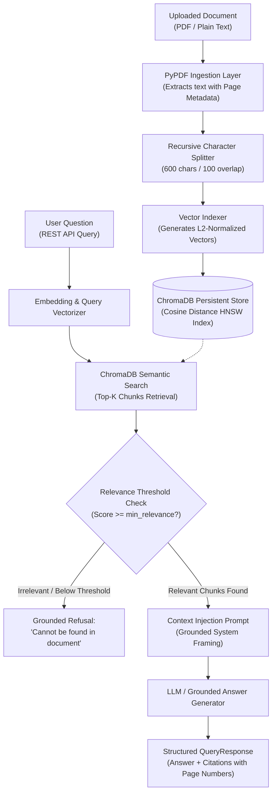

# 📚 RAG Document Q&A Prototype

[](https://www.python.org/downloads/)
[](https://fastapi.tiangolo.com)
[](https://www.trychroma.com/)
[](https://docs.pydantic.dev/)
[](https://opensource.org/licenses/MIT)

A lightweight, API-first **Retrieval-Augmented Generation (RAG)** prototype demonstrating the end-to-end document question-answering lifecycle:
1. **Document Ingestion & Provenance:** Parses PDF and text files, tracking page numbers for every extracted passage.
2. **Recursive Character Chunking:** Hierarchically segments text with configurable chunk size and overlap (default 600 / 100 characters) to avoid splitting semantic sentences.
3. **Vector Storage & Semantic Indexing:** Indexes chunk embeddings into **ChromaDB** with cosine distance space.
4. **Grounded Generation & Citation:** Returns factual answers citing the exact page number and text snippet.
5. **Hallucination Safeguard:** Enforces similarity score thresholds. If the retrieved context is insufficient or irrelevant, the API explicitly returns a refusal rather than inventing an answer.

---

## 👩‍💻 Hire the Developer / Контакти для замовлення

Потрібна розробка персональної RAG-системи, AI-асистента з пошуком по вашій корпоративній базі знань або автоматизація обробки PDF/документів?

* 💬 **Прямий зв'язок у Telegram:** [@Nataly_Zyma](https://t.me/Nataly_Zyma)
* 📧 **Офіційний Email:** `areonixwinter@gmail.com`
* 🤖 **Бот технічної підтримки:** [@AreonixSupport_bot](https://t.me/AreonixSupport_bot)
* 🏢 **Виконавець:** ФОП Зима Н. М. (офіційна розробка, робота з ФОП/ТОВ за безготівковим розрахунком)

---

## 🏛️ System Architecture



---

## 🚀 Quickstart & Setup

### 1. Installation
```bash
git clone https://github.com/zymaneta-eng/rag-document-qa.git
cd rag-document-qa

python -m venv .venv
source .venv/bin/activate  # On Windows: .venv\Scripts\activate
pip install -r requirements.txt
```

### 2. Run Automated Pytest Suite
```bash
pytest test_rag.py -v
```
All 5 automated tests verify PDF ingestion, page metadata tracking, vector retrieval, and refusal logic for out-of-context queries.

### 3. Start the FastAPI Microservice
```bash
uvicorn api:app --host 0.0.0.0 --port 8000 --reload
```
Interactive OpenAPI / Swagger documentation will be available at:
`http://localhost:8000/docs`

---

## 🧪 Testing with the Included Sample Document

A 3-page sample enterprise SLA document is pre-generated in `sample_docs/enterprise_sla_policy.pdf`.

### 1. Ingest the Sample Document
```bash
curl -X POST "http://localhost:8000/api/v1/upload" \
     -H "accept: application/json" \
     -H "Content-Type: multipart/form-data" \
     -F "file=@sample_docs/enterprise_sla_policy.pdf"
```
**Response:**
```json
{
  "filename": "enterprise_sla_policy.pdf",
  "total_pages": 3,
  "total_chunks": 6,
  "status": "indexed",
  "message": "Successfully extracted 6 chunks across 3 page(s)."
}
```

### 2. Ask an In-Scope Question
```bash
curl -X POST "http://localhost:8000/api/v1/query" \
     -H "Content-Type: application/json" \
     -d '{
       "question": "What is the initial response time for Severity 1 outages?",
       "top_k": 3,
       "min_relevance": 0.20
     }'
```
**Response:**
```json
{
  "question": "What is the initial response time for Severity 1 outages?",
  "answer": "According to page 1: - Severity 1 (Critical Outage): Initial response within 15 minutes, 24/7/365.",
  "answered_from_document": true,
  "citations": [
    {
      "chunk_id": "enterprise_sla_policy.pdf_p1_c1_...",
      "page_number": 1,
      "snippet": "Severity 1 (Critical Outage): Initial response within 15 minutes...",
      "relevance_score": 0.435
    }
  ],
  "latency_ms": 5.2
}
```

### 3. Ask an Unrelated Out-of-Context Question
```bash
curl -X POST "http://localhost:8000/api/v1/query" \
     -H "Content-Type: application/json" \
     -d '{
       "question": "What is the recipe for chocolate chip cookies?",
       "min_relevance": 0.20
     }'
```
**Response:**
```json
{
  "question": "What is the recipe for chocolate chip cookies?",
  "answer": "The answer to this question could not be found in the uploaded document.",
  "answered_from_document": false,
  "citations": [],
  "latency_ms": 2.1
}
```

---

## 🔍 Indexing & Retrieval Tuning Strategy

1. **Chunk Size & Overlap Trade-off:**
   - Shorter chunks (~300–500 chars) yield sharper semantic focus but risk splitting multi-sentence policies.
   - Longer chunks (~800–1200 chars) preserve full paragraphs but dilute vector relevance scores.
   - For this PoC, we start with 600 characters with 100-character overlap, benchmarked against real user queries.
2. **Similarity Distance Filtering:**
   - Rather than returning whatever top-k chunks match regardless of relevance, queries below the minimum cosine relevance threshold immediately trigger a refusal response.

---

## 📄 License
Released under the [MIT License](LICENSE).
